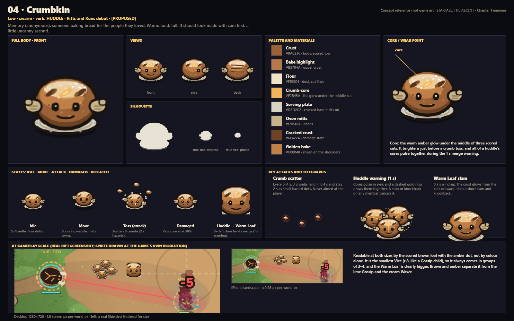
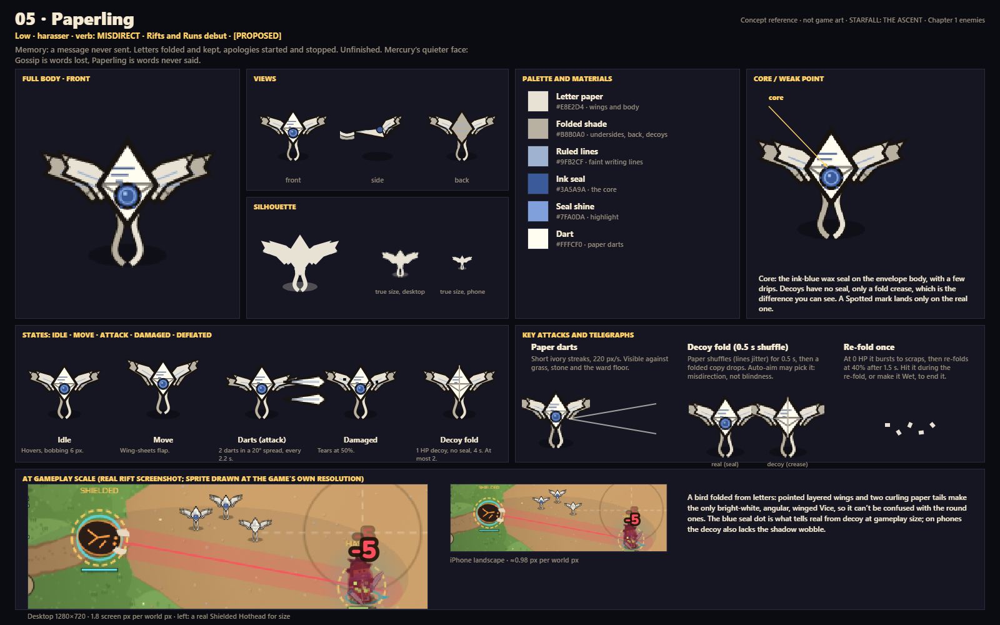
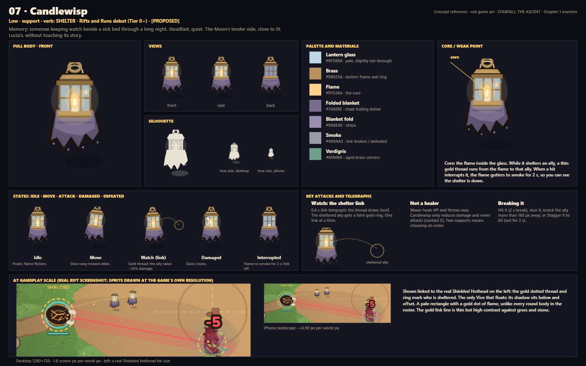
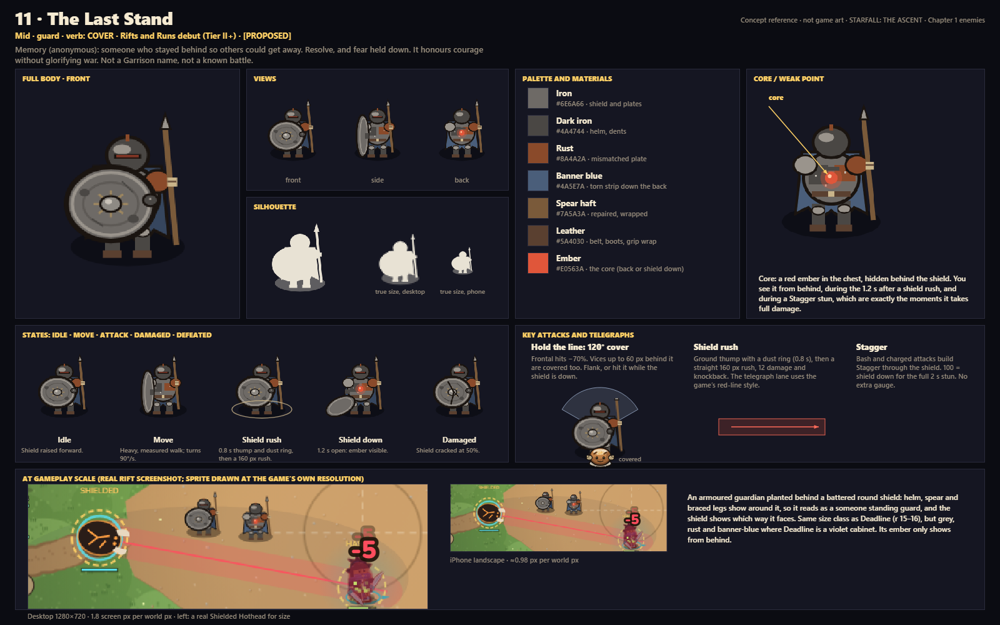
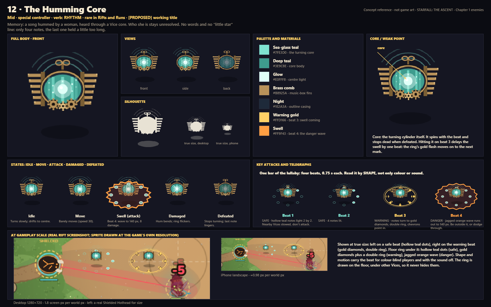
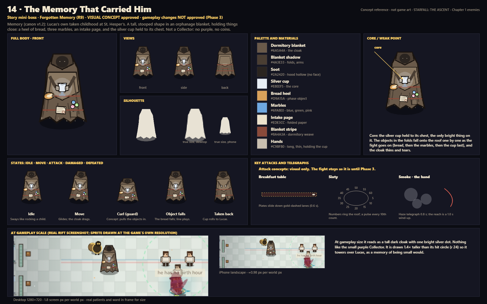

# Chapter 1 Enemy Design · Phase 2 visual references

**Status:**
- Concept references only. **No gameplay code, game assets or encounters were changed.**
- The Forgotten Memory fight is unchanged. #14's *gameplay* ideas are shown only as concepts for Phase 3.

**How the sheets were made:**
- Every STARFALL enemy is drawn in code, so these sheets are drawn the same way.
- Shapes are drawn in world units, rendered at low resolution and scaled up with hard pixels, matching the game's pixel-art buffer.
- Each sheet's **gameplay-scale panel** puts the sprite at its **true size** onto a **real screenshot of a Rift**, beside real Vices:
  - Desktop: 1280 × 720, where the game draws 1.8 screen px per world px and renders the world at 1.1 × that.
  - Phone crop: iPhone landscape, about 0.98 px per world px.

**Files:**
- Sheets: `docs/art/ch1_enemies/<id>.png`, 1600 × 1000 each.
- Renderer: `tools/enemy_concepts/sheets.html` (render with `node tools/enemy_concepts/render.js`).
- Backdrops: `bg_yard.png` and `bg_ward.png`, captured from the game. Each has a `.json` with the screen scale.

**What each sheet contains:**
- full-body front view;
- front, side and back views;
- silhouette, large and at true size;
- palette with hex values and materials;
- core or weak-point callout;
- states (idle, move, attack, damaged, defeated);
- key attacks and their telegraphs;
- the gameplay-scale check.

## The sheets
| # | Enemy | Sheet | What sets it apart at gameplay scale |
|---|---|---|---|
| 04 | Crumbkin |  | A brown scored loaf with an amber dot. Small, and always seen in groups; the Warm Loaf is clearly bigger |
| 05 | Paperling |  | The only white, angular, winged Vice. The **blue seal** tells the real one from a decoy (decoys have a crease) |
| 07 | Candlewisp |  | A floating lantern with an offset shadow and a gold flame. Its **gold dotted thread and ring** mark the sheltered ally |
| 11 | The Last Stand |  | A big grey half-moon shield, facing you. Its **red ember** shows only from behind or when the shield is down |
| 12 | The Humming Core |  | A teal music-box core with brass combs, and **a floor ring that carries the beat** |
| 14 | The Memory That Carried Him |  | A tall dark blanket-cloak with one **silver cup**; bread, marbles and the intake page in its folds. No Collector purple, no coins |

## The Humming Core: reading the beat without sound
The ring is drawn **on the floor, under other Vices**, with 8 marks around the core. Each beat is 0.75 s.

| Beat | Shape (primary cue) | Colour | Motion | Meaning |
|---|---|---|---|---|
| 1 | Hollow ovals; 2 of 8 light up | Teal | Marks fill in pairs | **Safe.** Nearby Vices are calmed |
| 2 | Hollow ovals; 4 of 8 lit | Teal | — | **Safe** |
| 3 | **Diamonds**, a **double ring** and **chevrons pointing in** | Gold | The ring tightens | **Warning:** the swell is next. Hitting the core now delays it one beat |
| 4 | **Jagged, saw-toothed wave** expanding out | Orange-red | Expands to 140 px | **Danger:** be outside it, or dodge through |

**Why shape comes first:** shape and motion change on every beat, not only colour, so the beat stays readable for colour-blind players and with the sound off. The sheet's gameplay panel shows a safe beat and a warning beat side by side at true size.

## Existing enemies
- **No refinements proposed.** The seven existing Vices, the Champion and Horaios keep their current look.
- At true size, the new designs were checked against a real **Shielded Hothead** in the same frame so none of them can be mistaken for an existing Vice:
  - Paperling is the only bright, angular Vice.
  - Candlewisp is the only floating, rectangular one.
  - The Last Stand is grey with a half-moon shield, where Deadline is a violet cabinet.
  - Crumbkin is brown with amber, where Gossip is lime and Waxer is cream.

## Findings from the true-size check (for Phase 3)
1. **Crumbkin on dirt.** Against the Garrison Yard's dirt path, the brown crust has low contrast. It still reads by shape (the scored top and the amber dot), but less strongly than the others. Suggestion: a lighter flour-dusted cap and a slightly darker outline. It's a small change to the approved palette, so I'm asking rather than doing it.
2. **Candlewisp's link on phones.** The gold thread is thin at about 0.98 px per world px. Suggestion: draw it 1.5× thicker on small screens. The ring on the sheltered ally reads well already.
3. **The Memory That Carried Him's views.** Front and side look alike, because a cloaked figure seen from above barely changes in profile. Its side view relies on the hood offset. This is fine for top-down play.
4. **The Last Stand's front view** reads strongly as "shield". The ember is deliberately invisible from the front, which is the mechanic.

## Refinement pass (round 2)
**Scope confirmed:**
- The 5 new Vices are **added to** the roster. All seven existing Vices, the Champion and Horaios stay unchanged.
- The Memory That Carried Him is **unique to Lucas's Forgotten Memory fight**. The normal Collector stays everywhere else.
- Only the six concept sheets changed; no game code, assets or encounters.

| Enemy | What was added |
|---|---|
| Crumbkin | Baked speckle texture, a **flour-dusted cap**, glowing middle cut with a highlight, stubby feet, quilted oven-mitt paws with stitching, a cracked plate with a painted rim, a tiny too-wide smile (cute, slightly uncanny) |
| Paperling | **Layered wing-sheets** (pointed, notched, dog-eared, ruled, creased), an **envelope body** with a flap and trailing handwriting, a wax seal with drips, **two curling paper tails**, a side view in flight |
| Candlewisp | **Aged brass cage**: domed cap with filigree, ring handle, verdigris on the corners. **Leaded glass** with a painted star, a candle stub, and a **layered, frayed blanket shawl** that fades like a ghost |
| The Last Stand | **Redesigned as an armoured guardian**: a helm with an ember-lit visor slit, mismatched pauldrons, rivets, a belt, **braced legs** with knee guards, a torn cloak, a repaired spear with a notched head. The battered round shield (dents, scratches, faded painted sun) is gripped by a gauntlet and held to one side, so the body shows around it. The ember core stays hidden behind the stance |
| The Humming Core | A **pinned brass drum turning** between tuned comb teeth of different lengths, a **wind-up key** that turns, a **three-gear train**, rising **sound-ripple arcs**, and a snapped tooth as its damage state |
| The Memory That Carried Him | **Long thin hands holding the silver cup** (with a dented rim). A **layered blanket** (hood, shawl and cloak) with folds, stripes, a **sewn patch** and a frayed hem; tears appear by phase. A bitten **bread heel**, three **swirled marbles**, and a ruled **intake page** with a stamp. A faint glint where eyes would be |

**Readability at true size:** checked again on the real Rift screenshot, desktop and phone.
- Every new detail sits inside the existing silhouettes, so each enemy reads the same at a glance.
- **Crumbkin's contrast finding is resolved:** the flour cap lifts it off the dirt.
- **Candlewisp's thin link on phones is still open** (a Phase 3 rendering choice).

## Approval needed for Phase 3
1. Approve or adjust the six designs as drawn.
2. Decide on the two small readability tweaks above (Crumbkin contrast, Candlewisp link thickness).
3. Phase 3 will write the full gameplay specs (timings, hitboxes, scaling, test matrix), including #14's proposed gameplay **for review only**.
